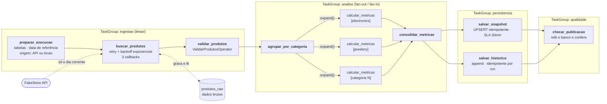
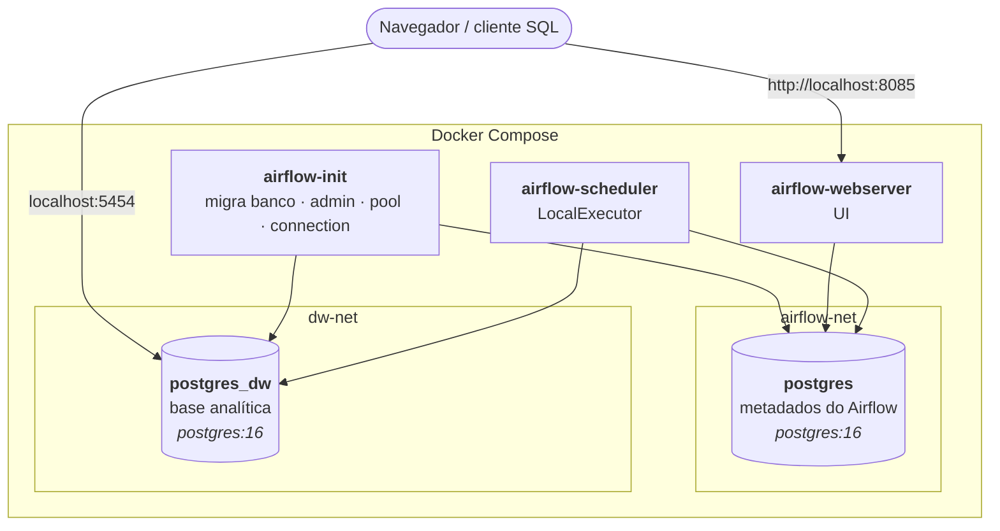

# ShopBrasil · Pipeline de preços por categoria (Apache Airflow)

Pipeline que substitui o script em cron que alimentava o painel de pricing da ShopBrasil.
Ele coleta os produtos da API de catálogo ([FakeStore API](https://fakestoreapi.com/docs)),
calcula **preço médio, mínimo, máximo e quantidade de produtos por categoria** e grava o
resultado no PostgreSQL, todo dia às **06:00 (horário de Brasília)**.

## TL;DR

```bash
git clone https://github.com/ana-delfino/airflow_atividade_01.git
cd airflow_atividade_01
cp .env.example .env
echo "AIRFLOW_UID=$(id -u)" >> .env   # só no Linux, evita erro de permissão em ./logs
docker compose up -d
```

**Acesse o Airflow: http://localhost:8085** (usuário `admin`, senha `admin`)

- A DAG `shopbrasil_precos_por_categoria` já nasce ativa e roda sozinha às 06:00.
- Resultado: `docker compose exec postgres_dw psql -U dw -d shopbrasil_dw -c "select * from vw_painel_precos;"`

> Se a porta 8085 ou 5454 estiver ocupada: `AIRFLOW_WEB_PORT=8090 DW_PORT=5460 docker compose up -d`
> (ou altere as variáveis no arquivo `.env`).

## Arquitetura

### Pipeline (DAG)



`buscar_produtos` grava o retorno da API em `produtos_raw` e lê de lá. Assim o cálculo usa
exatamente o que ficou guardado, e um dia passado pode ser recalculado a partir do bruto daquele dia.

As tasks `calcular_metricas` rodam no pool `ecommerce_pool` (2 slots): no máximo duas categorias
são processadas ao mesmo tempo, não importa quantas existam.

### Infraestrutura (Docker Compose)



| Serviço | Função |
|---|---|
| `postgres` | Banco de metadados do Airflow. **Não publica porta** no host |
| `postgres_dw` | Base analítica (`shopbrasil_dw`) onde as métricas são gravadas; porta publicada para o painel / clientes SQL |
| `airflow-init` | Roda uma vez: migra o banco, cria o usuário admin, o pool `ecommerce_pool` (2 slots) e a connection `postgres_dw` |
| `airflow-webserver` | Interface web |
| `airflow-scheduler` | Agenda e executa as tasks (LocalExecutor) |

## Estrutura do projeto

```
dags/
├── shopbrasil_precos_dag.py   # DAG (TaskFlow API): só orquestração
└── shopbrasil/                # módulos reutilizáveis (ignorados pelo parser via .airflowignore)
    ├── api.py                 # cliente da API de catálogo
    ├── transform.py           # regras puras: origem dos dados, validação, agrupamento, métricas
    ├── qualidade.py           # regras puras da checagem do que foi publicado
    ├── operators.py           # ValidarProdutosOperator(BaseOperator)
    ├── db.py                  # DDL e comentários + leitura/gravação com PostgresHook
    ├── callbacks.py           # callbacks de ciclo de vida, alertas e SLA
    └── exceptions.py          # exceções do domínio (CatalogoIndisponivel, DadosInvalidos, Persistencia)
tests/
├── test_transform.py          # regras de negócio e mensagens de validação
├── test_qualidade.py          # checagem de qualidade do snapshot
└── test_api.py                # mensagens de erro do cliente da API (sem rede)
pyproject.toml                 # padrão de código (ruff) e configuração do pytest
requirements-dev.txt           # ferramentas de desenvolvimento (pytest, ruff)
docker-compose.yaml            # infraestrutura
.env.example                   # modelo de configuração (copiar para .env)
```

## Padrão de código

Padrão definido para o time. Ele é **verificado automaticamente** pelo [ruff](https://docs.astral.sh/ruff/),
com as regras configuradas no [pyproject.toml](pyproject.toml):

```bash
pip install -r requirements-dev.txt
ruff check .          # lint: precisa terminar com "All checks passed!"
ruff format .         # formatação automática
pytest                # testes
```

### Organização: a DAG só orquestra

- O arquivo da DAG descreve **o fluxo** (tasks, grupos, dependências, retries), não a regra de negócio.
- Regras de negócio ficam em funções puras (`transform.py`), testáveis sem Airflow.
- I/O fica isolado: API em `api.py`, banco em `db.py`, alertas em `callbacks.py`.
- Dependências entre tasks saem da chamada das funções (TaskFlow), sem `>>`.

### Tratamento de erros

As exceções do projeto ficam em [exceptions.py](dags/shopbrasil/exceptions.py) e dizem **que tipo de
problema** aconteceu, o que define a reação do pipeline:

| Exceção | Quando | Reação |
|---|---|---|
| `CatalogoIndisponivelError` | API fora do ar, lenta, HTTP de erro, resposta que não é JSON ou lista vazia | **Transitório**: relançada para o Airflow fazer retry com backoff |
| `DadosInvalidosError` | Dados fora do contrato (schema, categoria sem preço) | **De conteúdo**: retry não resolve (`validar_produtos` tem `retries=0`) |
| `PersistenciaError` | Connection inexistente, banco inacessível, falha na gravação | Transação desfeita (nada gravado pela metade); 1 retry |
| `AirflowFailException` | Reprocessar um dia que não tem dados brutos | **Falha na hora, sem retry**: esperar não faz o dado aparecer |

Regras:
- Capture exceções **específicas** (`requests.Timeout`, `psycopg2.OperationalError`), nunca `except:` genérico.
- Ao traduzir um erro, use **`raise NovoErro(...) from exc`** para manter a causa original no traceback.
- Para acionar o retry, **relance** (`raise`) em vez de engolir o erro.
- Um alerta que falha (ex.: webhook fora) **nunca** derruba a task: o erro é só registrado no log.

### Mensagens de erro

Toda mensagem segue o formato **o que aconteceu (contexto). O que fazer.** Quem está de plantão às
06:00 precisa entender o problema pelo alerta, sem abrir o código:

```text
A API de catálogo respondeu HTTP 503 (GET https://fakestoreapi.com/products, resposta: 'Service Unavailable').
Instabilidade do lado da API: a task será retentada automaticamente.

Não foi possível conectar à base analítica (connection 'postgres_dw': OperationalError: could not translate
host name "postgres_dw" to address). Verifique se o container postgres_dw está no ar (docker compose ps) e se
host, porta, usuário e senha da connection estão corretos.

Lote reprovado: 5 de 20 produtos inválidos (25%), acima do limite de 20%. Exemplos: id=3: price deve ser
numérico, recebido str '10,5' | ... Provável mudança no contrato da API: confira a lista completa no log desta task.
```

- **Contexto obrigatório**: URL, HTTP status, connection, categoria, id do produto, tentativa, conforme o caso.
- **Valor recebido**: validações mostram tipo e valor (`recebido str '10,5'`), não só "inválido".
- **Ação sugerida**: diz se o Airflow vai retentar sozinho ou o que a pessoa deve verificar.
- **Nada sensível**: mensagens não incluem senhas. O Airflow ainda mascara com `***` a senha das
  connections em todos os logs, por isso a senha nunca deve ser uma palavra que aparece em nomes
  (com a senha `dw`, até `postgres_dw` virava `postgres_***`).
- As mensagens de erro são **testadas** ([tests/test_api.py](tests/test_api.py),
  [tests/test_transform.py](tests/test_transform.py)), para não perderem o contexto em refatorações.

## Decisões de design

### Resiliência do pipeline

- **API instável**: `buscar_produtos` tenta até 6 vezes com backoff exponencial (15s, 30s, 60s…
  até 10min) e `execution_timeout` de 2min, para não ficar presa numa requisição pendurada.
  Erros de rede, HTTP ou JSON inválido são capturados (`try/except`) e relançados para acionar o retry.
- **Contrato da API**: o `ValidarProdutosOperator` descarta registros inválidos e falha a execução
  se mais de 20% vierem quebrados, em vez de publicar um painel com números errados.
- **Produtos duplicados**: se a API devolver o mesmo `id` mais de uma vez, fica só a primeira
  ocorrência, para o produto não contar em dobro na quantidade e no preço médio. Duplicados são
  registrados no log, mas não contam como inválidos.
- **Dados brutos**: o retorno da API é gravado como chegou em `produtos_raw` (JSONB), e as métricas
  são calculadas a partir dele. Se uma regra de cálculo mudar ou aparecer um bug, dá para recalcular
  os dias passados.
- **Reprocessar um dia passado**: a API só devolve preços **atuais**. Por isso só a execução do dia
  corrente consulta a API (`preparar_execucao` decide a origem). Reprocessar um dia antigo usa o
  bruto gravado naquele dia; se ele não existir, a execução falha na hora (`AirflowFailException`, sem
  retry), com uma mensagem clara, e o snapshot do dia não é alterado. Sem essa regra, os preços de
  hoje seriam gravados com a data antiga.
- **Snapshot idempotente**: numa única transação (tudo ou nada), o snapshot faz `INSERT ... ON CONFLICT DO UPDATE`
  e remove as categorias do mesmo dia que não vieram na nova carga. Rodar de novo o mesmo dia atualiza
  as linhas em vez de duplicar, e uma categoria que saiu da API não fica no painel com números antigos.
- **Histórico idempotente por execução**: cada execução acrescenta linhas (append), mas reprocessar a
  **mesma** execução atualiza as linhas dela, com chave única `(run_id, categoria)`, em vez de duplicar.
- **Checagem do que foi publicado**: depois das gravações, `checar_publicacao` relê o banco e confere:
  - o snapshot do dia existe e tem exatamente as categorias calculadas;
  - mínimo ≤ médio ≤ máximo, sem preço negativo;
  - a soma de `qtd_produtos` é igual ao total de produtos válidos;
  - o histórico tem uma linha por categoria para esta execução.

  Se algo falhar, o alerta traz a lista completa de problemas.
- **Valores monetários**: as métricas são calculadas em `Decimal` e arredondadas "meio para cima"
  (2,675 → 2,68). Com `float`, o Python arredondaria para 2,67.
- **XCom pequeno**: depois da validação, os produtos seguem só com `id`, `category` e `price`.
- **Alertas**: `on_failure_callback` em todas as tasks e `sla_miss_callback` se o painel não estiver
  pronto até 06:30. O alerta aparece em destaque no log e, se `ALERT_WEBHOOK_URL` estiver definida,
  é enviado para um webhook (Slack/Teams).
- **Escala**: as categorias vêm dos dados. Uma categoria nova na API vira uma nova task mapeada
  sem mudar código, e o pool garante que isso não sobrecarregue o ambiente.

### Serviços e versões

- **Airflow 2.10.5** (imagem oficial `apache/airflow`, Python 3.11): versão madura da linha 2.x, que
  ainda suporta `sla`/`sla_miss_callback` (removidos no Airflow 3). Já inclui o provider Postgres,
  então não é preciso construir imagem própria.
- **PostgreSQL 16**: versão suportada oficialmente pelo Airflow 2.10 como banco de metadados.
  Os dois bancos usam a mesma versão para simplificar a manutenção.
- **LocalExecutor**: executa tasks em paralelo (necessário para o fan-out e para o pool fazer
  diferença) sem precisar de Redis/Celery.
- **Dois bancos separados**: os metadados do Airflow e os dados de negócio têm ciclos de vida
  diferentes. Recriar o Airflow não afeta a base analítica, e vice-versa.

### Resiliência dos containers

- Todos os serviços de longa duração usam `restart: unless-stopped`: o Docker reinicia o container
  se ele cair (inclusive após reiniciar a máquina), mas respeita uma parada manual
  (`docker compose stop`). O `airflow-init` usa `restart: "no"`, porque roda uma vez e termina.
- Todos têm **healthcheck** (`pg_isready` nos bancos, `/health` no webserver e no scheduler),
  visível em `docker compose ps`.
- `depends_on` com `condition: service_healthy` faz o Airflow esperar os bancos aceitarem conexões,
  e `service_completed_successfully` faz webserver e scheduler esperarem o `airflow-init` terminar.

### Volumes

- Os dados dos dois bancos ficam em **volumes nomeados** gerenciados pelo Docker
  (`postgres-airflow-data` e `postgres-dw-data`), separados dos containers: dá para recriar ou
  atualizar os containers sem perder dados. Eles só são apagados com `docker compose down -v`.
- `dags/`, `plugins/` e `config/` são montados **somente leitura** (`:ro`): o container não altera o
  código. Só `logs/` é gravável.

### Redes

- **`airflow-net`**: só o banco de metadados e os serviços do Airflow. O banco de metadados não
  publica porta e não é acessível de fora.
- **`dw-net`**: a base analítica e os serviços do Airflow que gravam nela.
- O Airflow participa das duas redes. A base analítica não enxerga o banco de metadados.

### Segurança

- As senhas das Connections ficam **criptografadas** no banco de metadados (`AIRFLOW_FERNET_KEY`).
- Credenciais e chaves ficam no `.env`, que não vai para o repositório; o `.env.example` traz
  valores de desenvolvimento. Em produção, gere chaves novas (comando no `.env.example`).

### Variáveis de ambiente (`.env`)

Todas as configurações que podem mudar ficam no `.env`. O Docker Compose lê esse arquivo
automaticamente e o `docker-compose.yaml` traz os mesmos valores como padrão (`${VAR:-padrão}`),
então o projeto sobe mesmo sem ele. Uma variável definida no terminal tem prioridade sobre o `.env`.

| Variável | Para que serve |
|---|---|
| `AIRFLOW_IMAGE` / `AIRFLOW_VERSION` | Imagem e versão do Airflow |
| `POSTGRES_VERSION` | Versão do Postgres (metadados e base analítica) |
| `AIRFLOW_WEB_PORT` / `DW_PORT` | Portas do host para a UI e para a base analítica |
| `AIRFLOW_UID` | UID do usuário dos containers (no Linux, use `id -u`) |
| `AIRFLOW_ADMIN_USER` / `AIRFLOW_ADMIN_PASSWORD` | Login da UI |
| `AIRFLOW_FERNET_KEY` / `AIRFLOW_SECRET_KEY` | Criptografia das connections / sessão do webserver |
| `AIRFLOW_DB_USER` / `AIRFLOW_DB_PASSWORD` / `AIRFLOW_DB_NAME` | Credenciais do banco de metadados |
| `DW_USER` / `DW_PASSWORD` / `DW_DB` | Credenciais da base analítica (também usadas na connection `postgres_dw`) |
| `FAKESTORE_API_URL` | URL base da API de catálogo |
| `ALERT_WEBHOOK_URL` | Webhook opcional para receber os alertas |

## Instalação e execução

### Pré-requisitos

- Docker 24+ e Docker Compose v2 (`docker compose version`)

### Subir

```bash
cp .env.example .env
echo "AIRFLOW_UID=$(id -u)" >> .env   # só no Linux (veja a nota abaixo)
docker compose up -d
docker compose ps          # bancos, webserver e scheduler devem ficar (healthy)
```

> **Linux:** os containers do Airflow rodam com o UID definido em `AIRFLOW_UID` (padrão `50000`).
> A pasta `./logs` pertence ao seu usuário, então com o valor padrão o Airflow não consegue gravar
> os logs e as tasks falham com `PermissionError`. Por isso, no Linux, defina `AIRFLOW_UID` com o seu
> UID (`id -u`), como no comando acima. No macOS e no Windows (Docker Desktop) isso não é necessário.

Abra **http://localhost:8085** (usuário `admin`, senha `admin`).

### Usar

- **Rodar na hora**: na UI, **Trigger DAG**.
- **Simular a API instável**: **Trigger DAG w/ config** com `{"simular_falha_api": true}`. As 2
  primeiras tentativas de `buscar_produtos` falham de propósito, os alertas de RETRY aparecem no
  log e a 3ª tentativa conclui.
- **Consultar o resultado** (o painel lê a view `vw_painel_precos`):

```bash
docker compose exec postgres_dw psql -U dw -d shopbrasil_dw -c "select * from vw_painel_precos;"
```

Ou conecte qualquer cliente SQL em `localhost:5454` (db `shopbrasil_dw`, usuário `dw`, senha `senha_analitica_local`).

### Testes e lint

```bash
pip install -r requirements-dev.txt
pytest            # 49 testes, sem Airflow e sem rede
ruff check .      # padrão de código
```

### Operações comuns

```bash
docker compose logs -f airflow-scheduler     # logs do scheduler
docker compose exec airflow-scheduler airflow dags list-import-errors   # erros de parse das DAGs
docker compose down                          # parar tudo (os dados são mantidos)
docker compose down -v                       # parar tudo e APAGAR os bancos
```

## Atualização dos componentes

As versões estão centralizadas no `.env`:

```dotenv
AIRFLOW_IMAGE=apache/airflow
AIRFLOW_VERSION=2.10.5-python3.11
POSTGRES_VERSION=16
```

- **Airflow (patch/minor na linha 2.x)**: troque `AIRFLOW_VERSION` e rode `docker compose up -d`.
  O `airflow-init` roda `airflow db migrate` e atualiza o banco de metadados.
- **Postgres (patch/minor, mesma major)**: troque `POSTGRES_VERSION` (ex.: `16.6`) e rode
  `docker compose up -d`. Os dados continuam nos volumes.
- **Postgres (nova major)**: exige migração dos dados. Faça um dump antes, troque a versão,
  recrie o volume e restaure:

```bash
docker compose exec postgres_dw pg_dumpall -U dw > backup_dw.sql
docker compose down
docker volume rm airflow_atividade_01_postgres-dw-data
POSTGRES_VERSION=17 docker compose up -d postgres_dw
cat backup_dw.sql | docker compose exec -T postgres_dw psql -U dw -d shopbrasil_dw
docker compose up -d
```

## Modelo de dados (`shopbrasil_dw`)

| Objeto | Conteúdo | Chave |
|---|---|---|
| `produtos_raw` | Retorno da API como chegou (JSONB), 1 linha por produto por dia. Recoletar o mesmo dia substitui as linhas daquele dia | `(data_referencia, posicao)` |
| `metricas_categoria` | Snapshot das métricas; reflete exatamente a última carga de cada dia | `(data_referencia, categoria)` |
| `metricas_categoria_historico` | Uma linha por categoria por execução, para acompanhar a evolução dos preços | único `(run_id, categoria)` |
| `vw_painel_precos` | View com o dia mais recente, consumida pelo painel | - |

`data_referencia` é a data (em Brasília) do fim do intervalo agendado, ou seja, o dia em que a
coleta das 06:00 acontece. Execuções manuais no mesmo dia caem na mesma data e atualizam o
mesmo snapshot.

**Documentação no banco**: tabelas, colunas e a view têm `COMMENT ON`, então a descrição aparece em
qualquer cliente SQL (`\d+ metricas_categoria` no psql, DBeaver, etc.), sem precisar deste README:

```bash
docker compose exec postgres_dw psql -U dw -d shopbrasil_dw -c "\d+ metricas_categoria"
```

## Validação realizada

- **Agendamento**: a execução agendada saiu às 09:00 UTC, que é 06:00 em Brasília.
- **Fluxo completo**: ingestão, 4 categorias calculadas em paralelo e gravação no `postgres_dw`.
- **Pool**: as 4 tasks `calcular_metricas` rodaram 2 por vez.
- **Idempotência**: depois de 4 execuções bem-sucedidas no mesmo dia, `metricas_categoria` tinha
  4 linhas (uma por categoria) e `metricas_categoria_historico` tinha 16.
- **API instável** (`simular_falha_api`): duas falhas com alertas de RETRY e intervalo crescente
  entre as tentativas (~17s, depois ~38s); a 3ª tentativa concluiu e chamou o callback de sucesso.
- **Banco fora do ar** (`postgres_dw` parado): a task que cria as tabelas falhou após o retry, o
  `[ALERTA FALHA]` saiu no log e as gravações ficaram `upstream_failed`, sem dados pela metade.
- **Connection criptografada**: `is_encrypted = true` na tabela `connection` do Airflow.
- **Containers**: todos os serviços `(healthy)` em `docker compose ps`; dados preservados após
  `docker compose down` + `up`.
- **Mensagens de erro**: com o banco fora do ar, o alerta trouxe a connection, a causa e o que verificar;
  com a falha simulada da API, o alerta de RETRY trouxe tentativa, tipo do erro e motivo.
- **Categoria que sumiu da API**: inseri `categoria_extinta` no snapshot do dia e reprocessei. Ela foi
  removida, e o log registrou `1 categoria(s) removida(s) por não constarem nesta carga`.
- **XCom enxuto**: o XCom de `validar_produtos` caiu de 2.393 para 1.104 bytes.
- **Dados brutos**: a coleta do dia gravou os 20 produtos em `produtos_raw`, e as métricas foram
  calculadas a partir deles.
- **Reprocessar dia sem bruto**: a run de 20/11 falhou na 1ª tentativa, sem retry, com a mensagem
  `Não há dados brutos de 2026-11-20 ... O snapshot desse dia não foi alterado`, e o alerta saiu no log.
- **Reprocessar dia com bruto**: gravei um bruto simulado de 21/11 com todos os preços em R$ 10. A run
  de 21/11 gerou métricas de R$ 10,00, provando que usou o bruto e não os preços atuais da API.
- **Histórico idempotente**: depois de limpar e reprocessar a mesma run, o histórico dela continuou com
  4 linhas.
- **Checagem de qualidade**: aprovada em todas as execuções bem-sucedidas.
- **Testes e lint**: 49 testes passando (regras de negócio, origem dos dados, validação do lote,
  duplicados, arredondamento monetário, checagem de qualidade e mensagens de erro); `ruff check .`
  sem apontamentos.
